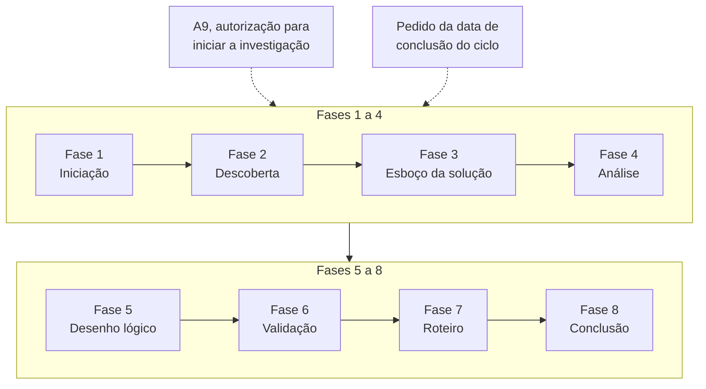

# Autor: Guilherme Marques

### Consulta dos enunciados em: https://aulas-marco.github.io/projeto-arquitetura-software/modulo-1-fundamentos/

## Exercício 1 — Arquitetura de soluções e arquitetura de software

### 1.1 Classificação das nove decisões

| Decisão | Enunciado | Classificação | Justificativa |
|---|---|---|---|
| D1 | Identidade e autorização seguem padrões abertos, sem produto proprietário, em qualquer iniciativa da universidade | Arquitetura corporativa | É um princípio de padronização que vale para qualquer iniciativa da universidade, não para uma solução específica. |
| D2 | A propagação de nota ao ambiente virtual de aprendizagem deixa de ser lote diário e passa a ocorrer em até 10 minutos | Arquitetura de solução | É um requisito de negócio que atravessa o sistema acadêmico e o ambiente virtual e muda o processo de propagação de nota. |
| D3 | O serviço de notas repete o envio ao ambiente virtual quando não recebe confirmação, com intervalo crescente entre tentativas | Arquitetura de software | É um padrão de resiliência (repetição com espera crescente) interno ao serviço de notas. |
| D4 | Nenhum dado pessoal de aluno é processado fora do território nacional | Arquitetura corporativa | É uma restrição institucional sobre dado pessoal, aplicável a todos os sistemas e a todas as iniciativas. |
| D5 | A Secretaria Acadêmica passa a responder pela correção de dado cadastral de aluno, hoje feita pela equipe de sustentação | Arquitetura de solução | Redefine quem responde pela correção do dado, ou seja, uma mudança organizacional dentro da solução de modernização. |
| D6 | O índice de busca de disciplinas do portal passa a ser mantido em memória, para reduzir o tempo de resposta na abertura da matrícula | Arquitetura de software | É uma tática de desempenho (índice em memória) dentro de um único componente, sem efeito fora dele. |
| D7 | O núcleo em COBOL permanece sob o contrato da fábrica de software até 30/09/2027, e as alterações nele dependem desse fornecedor | Arquitetura de solução | É uma restrição contratual específica da iniciativa, que condiciona a coexistência com o núcleo e a ordem de entrega. |
| D8 | O histórico escolar é emitido com assinatura digital no padrão ICP-Brasil | Arquitetura de solução | Exige conformidade que envolve processo de emissão, informação (documento) e tecnologia (certificado) numa única solução. |
| D9 | A transição ocorre por extração incremental de módulos, com o núcleo em operação durante todo o percurso | Arquitetura de solução | É a estratégia de transição da iniciativa, que organiza a coexistência entre o núcleo e os módulos novos. |

Resumo: corporativa (D1, D4), solução (D2, D5, D7, D8, D9) e software (D3, D6).

### 1.2 Componente não tecnológico afetado (duas decisões de solução)

- **D5 — estruturas organizacionais.** A responsabilidade pelo dado cadastral passa da equipe de sustentação (TI) para a Secretaria Acadêmica, o que altera quem é dono do dado e quem responde por ele.
- **D2 — processos.** O fluxo de propagação da nota deixa de ser o lote noturno e passa a ocorrer em até 10 minutos. Isso muda a rotina de lançamento, revisão e retificação de nota.

### 1.3 D3 sem que D2 tenha sido decidida antes

D3 (repetir o envio com intervalo crescente) só tem parâmetros definíveis se houver um prazo a cumprir, e esse prazo é o de D2 (10 minutos).

Sem D2, o serviço de notas seria projetado sem limite de tempo. Os intervalos crescentes poderiam passar de 10 minutos, e a nota chegaria ao ambiente virtual fora do prazo que a Coordenação de EAD exige.

Também não haveria como dizer se a repetição resolve o problema real (a reclamação do aluno no fechamento noturno). Ela seria um mecanismo de robustez aplicado ao lote diário, que deve ser substituído.

O custo seria retrabalho: ajustar ou refazer a política de tentativas depois de D2, com orçamento de R$ 6,2 milhões e 12 meses já em curso. A ordem correta é D2 primeiro, que fixa o objetivo e o prazo. Depois vem D3, dimensionada para que a soma das tentativas caiba dentro dos 10 minutos.

---

## Exercício 2 — A solução como sistema e seus componentes

### 2.1 Componentes da solução do R7

#### 2.1.1 Classificação dos componentes candidatos da solução que atende ao R7

| Componente | Classificação |
|---|---|
| C1 — Treinamento dos professores para o lançamento de nota com publicação imediata | Pessoas |
| C2 — Aditivo ao contrato com o fornecedor do ambiente virtual, com a troca para o plano que oferece interfaces de programação | Estruturas organizacionais |
| C3 — Acordo de nível de serviço de 10 minutos entre a Diretoria de TI e a Coordenação de Educação a Distância | Estruturas organizacionais |
| C4 — Procedimento de correção de nota já publicada no ambiente virtual | Processos |
| C5 — Fechamento de notas sem dependência da janela noturna de lote | Processos |
| C6 — Registro de cada envio de nota com o horário de lançamento e o horário de confirmação pelo ambiente virtual | Informação |
| C7 — Mensagem de nota lançada, com aluno, turma, avaliação e valor | Informação |
| C8 — Mensageria entre o núcleo acadêmico e o ambiente virtual | Tecnologia |
| C9 — Serviço de notas que publica um evento a cada lançamento | Tecnologia |
| C10 — Responsável na Coordenação de Educação a Distância pelo acompanhamento das falhas de envio | Estruturas organizacionais |

**Nenhum tipo ficou sem componente.** A distribuição é: pessoas (C1), estruturas organizacionais (C2, C3, C10), processos (C4, C5), informação (C6, C7) e tecnologia (C8, C9). Pessoas é o tipo com menos cobertura, apenas C1.

Critérios nos casos menos óbvios:

- **C1** é capacitação, ou seja, competência das pessoas que operam a solução. Não é processo, porque não define o fluxo, e sim prepara quem o executa.
- **C2** é um arranjo contratual com um terceiro, portanto estrutura organizacional. A tecnologia é a interface de programação que o plano passa a oferecer, não o aditivo em si.
- **C3** é um compromisso formal entre duas unidades da universidade. Ele define responsabilidade e meta entre áreas, sem descrever fluxo nem sistema.
- **C10** atribui um papel e uma responsabilidade dentro de uma unidade, o que é estrutura organizacional. Pessoas seria a classificação se o componente fosse a capacitação ou a alocação de indivíduos.
- **C6** é um registro de dados (informação), ainda que seja gravado por um sistema. **C7** é o conteúdo da mensagem (informação), enquanto **C8** é o mecanismo que a transporta (tecnologia).

#### 2.1.2 Tipo com maior impacto sobre quem trabalha

**Processos.** O professor e a Secretaria deixam de contar com a janela noturna para revisar e corrigir, porque o lançamento passa a ter efeito visível ao aluno em minutos. Isso obriga a rever a rotina de conferência, de retificação e de fechamento, o que a tecnologia sozinha não altera.

### 2.2 Os três níveis do R7

#### 2.2.1 Os seis elementos da situação atual nos três níveis

| Elemento | Nível |
|---|---|
| N1 — Serviço de avaliação que a universidade presta ao aluno, com o resultado publicado dentro do calendário acadêmico | Sistema de negócio |
| N2 — Calendário acadêmico que fixa a data de fechamento das notas de cada período | Sistema de negócio |
| N3 — Rotina de conferência manual das notas antes da publicação | Sistema de negócio |
| N4 — Registros de nota que circulam entre professor, coordenação de curso e Secretaria Acadêmica | Sistema de informação |
| N5 — Portal do professor e núcleo em COBOL que calcula a situação do aluno | Sistema de TI |
| N6 — Exportação noturna por lote das notas ao ambiente virtual de aprendizagem | Sistema de TI |

Critérios:

- **N1, N2 e N3** são o serviço prestado, a regra que o governa e a rotina humana de trabalho. Existem independentemente de qualquer sistema, portanto pertencem ao negócio.
- **N4** trata do fluxo e da guarda da informação entre os atores, não do software que a processa, o que o coloca no sistema de informação.
- **N5 e N6** são aplicações e mecanismos de execução, portanto sistema de TI.

#### 2.2.2 Por que só o nível de TI pode não reduzir o prazo percebido

 O aluno mede o tempo entre a avaliação e o momento em que vê a nota, e a exportação em lote (N6) é só um dos fatores desse prazo. Substituí-la por uma integração em até 10 minutos não altera a conferência manual (N3) nem a data de fechamento fixada no calendário (N2), que continuam segurando a publicação. Também não muda o fluxo de registros entre professor, coordenação e Secretaria (N4). Se a nota só pode ser publicada após o fechamento ou a conferência, ela chega ao aluno no mesmo momento de antes, mesmo com a tecnologia mais rápida.

---

## Exercício 3 — O papel do arquiteto de solução

### 3.1 Separação das tarefas em três grupos

**Arquiteto de solução**

| Tarefa | Justificativa |
|---|---|
| T1 — Entrevistar a Pró-Reitoria de Graduação e a Coordenação de Educação a Distância para levantar o que cada área precisa do sistema | Levantar o que cada área precisa é a base para o escopo e para os requisitos da solução. |
| T3 — Estimar o custo da mudança tecnológica do primeiro ciclo e verificar se cabe nos R$ 6,2 milhões | Estimar o custo e verificar se cabe no orçamento é viabilidade da solução como um todo. |
| T5 — Negociar com a fábrica de software a abertura de interfaces no núcleo antes do fim do contrato | Negociar com o fornecedor a abertura de interfaces é uma dependência de entrega da solução. |
| T7 — Produzir o roteiro de entrega do ciclo, com a ordem em que os módulos são extraídos | O roteiro do ciclo define a ordem de extração e coordena os módulos da solução. |
| T8 — Decidir que a Secretaria Acadêmica passa a responder pela correção de dado cadastral de aluno | Definir a responsabilidade da Secretaria é uma decisão organizacional dentro da solução. |
| T10 — Verificar com a Diretoria de TI se já existe na universidade um componente de envio de mensagem que possa ser reaproveitado | Consultar a TI para reaproveitar componente existente evita construir o que já há, com apoio do catálogo mantido pela arquitetura corporativa. |

**Arquiteto de software / equipe de desenvolvimento**

| Tarefa | Justificativa |
|---|---|
| T2 — Definir como o serviço extraído mantém consistência de dado com o núcleo em COBOL durante a coexistência | O mecanismo de consistência de dado (ex.: sincronização, evento transacional) é desenho técnico do serviço e da integração. O arquiteto de solução apenas fixa o nível de consistência aceitável. |
| T4 — Escolher a estrutura de dados que o serviço de matrícula usa para ordenar a lista de turmas disponíveis | A estrutura de dados que ordena a lista de turmas é decisão interna de um componente. |
| T9 — Configurar o servidor de integração contínua que compila e publica o serviço extraído | Configurar o servidor de integração contínua é trabalho de engenharia de construção e publicação. |

**Arquitetura corporativa**

| Tarefa | Justificativa |
|---|---|
| T6 — Redigir a política institucional que define como qualquer sistema da universidade trata dado pessoal de aluno | A política sobre dado pessoal vale para qualquer sistema da universidade e não só para esta solução. |

### 3.2 Grupo de competência principal (tarefas do arquiteto de solução)

Grupos de competência considerados:

| Grupo | O que abrange |
|---|---|
| Negócio | Estratégia da organização, modelo operacional atual e planejado, política interna, fatores comerciais e de mercado e leitura do ambiente externo |
| Técnico | Estratégia técnica, arquitetura de infraestrutura e de tecnologia vigente e planejada, e abordagens metodológicas de desenvolvimento |
| Entrega | Gestão de projetos, de programas e de portfólio, gestão de mudança e de configuração, e gestão de riscos |
| Prático | Comunicação, gestão de partes interessadas, tratamento de requisitos, resolução de problemas, inovação e liderança |

Classificação das tarefas:

| Tarefa | Competência | Motivo |
|---|---|---|
| T1 — Entrevistar a Pró-Reitoria de Graduação e a Coordenação de Educação a Distância para levantar o que cada área precisa do sistema | Prático | Tratamento de requisitos por meio de entrevistas, com comunicação e gestão das partes interessadas. |
| T3 — Estimar o custo da mudança tecnológica do primeiro ciclo e verificar se cabe nos R$ 6,2 milhões | Entrega | Estimativa de custo, orçamento e viabilidade. |
| T5 — Negociar com a fábrica de software a abertura de interfaces no núcleo antes do fim do contrato | Prático | Negociação e influência junto ao fornecedor. |
| T7 — Produzir o roteiro de entrega do ciclo, com a ordem em que os módulos são extraídos | Entrega | Planejamento, sequenciamento e marcos. |
| T8 — Decidir que a Secretaria Acadêmica passa a responder pela correção de dado cadastral de aluno | Negócio | Entender a organização e redefinir responsabilidades. |
| T10 — Verificar com a Diretoria de TI se já existe na universidade um componente de envio de mensagem que possa ser reaproveitado | Técnico | Conhecimento do portfólio de componentes e dos padrões da instituição. |

### 3.3 O benefício por trás de T10

**Benefício: reutilização** de componentes e ativos já existentes na instituição.

Se a verificação não for feita antes de especificar componente novo, a instituição perde de três formas:

- paga para construir algo que já existe, gastando orçamento e prazo dos R$ 6,2 milhões e dos 12 meses;
- aumenta o custo de manutenção (hoje R$ 15,83 milhões por ano) e a dependência de poucos especialistas, ao ter dois componentes para a mesma função;
- cria duplicidade de comportamento e de operação (reenvio, registro, monitoramento), o que fragmenta o parque tecnológico.

---

## Exercício 4 — O processo de definição da arquitetura

### 4.1 Fase e papel de cada artefato

O processo tem oito fases, na ordem abaixo.

| Fase | Entrada principal | Atividade central | Saída |
|---|---|---|---|
| Iniciação | Conceito de solução com apoio de partes interessadas seniores | Definir e documentar a área do problema em detalhe suficiente para decisão | Decisão de prosseguir ou não para a descoberta, com prazo e recurso definidos |
| Descoberta | Descrição da área do problema | Investigar requisitos de negócio, arquitetura existente e partes interessadas | Base factual completa para o desenho, com causas identificadas |
| Definição do esboço da solução | Insumos da descoberta | Produzir um ou mais desenhos conceituais de alto nível para estimular retorno do negócio | Esboços de solução, também chamados de desenho conceitual |
| Análise | Esboços de solução | Comparar alternativas no caso de negócio, escolher uma e definir o escopo da mudança | Opção única escolhida, com catálogo de blocos de construção e interfaces |
| Desenho lógico | Catálogo de blocos e interfaces | Reunir as saídas da análise em um modelo único de componentes e interações | Desenho lógico da solução, com mudanças organizacionais, de informação, de processo e de tecnologia |
| Validação | Desenho lógico | Verificar o desenho com pontos de vista e visões, análise de impacto e análise de lacunas | Desenho validado, ou lista de correções que exigem retrabalho |
| Desenvolvimento do roteiro | Desenho validado e resultado das análises | Ordenar as mudanças em sequência viável, tratando risco e prioridade das partes interessadas | Roteiro de entrega autorizado pelo patrocinador de negócio |
| Conclusão | Roteiro autorizado | Implementar o desenho com as disciplinas de execução, com a arquitetura em papel de governança | Artefatos da solução implantada nos níveis conceitual, lógico e físico |

#### 4.1.1 Artefatos, fases e papel

| Artefato | Fase | Papel |
|---|---|---|
| A1 — Mapa de atores com o que cada área quer e o que teme | Descoberta | Produto intermediário (resultado da investigação das partes interessadas). |
| A2 — Inventário dos componentes atuais do sistema acadêmico, com idade, responsável e tipo de integração | Descoberta | Entrada (descreve a arquitetura existente). |
| A3 — Catálogo de blocos de construção da solução escolhida, com as interfaces entre eles | Análise | Produto intermediário (alimenta o desenho lógico). |
| A4 — Registro da decisão da Reitoria de 12/03/2026 que descartou a substituição por produto de mercado | Descoberta | Entrada (restrição que já vale e limita as alternativas). |
| A5 — Comparação de duas alternativas de modernização apresentadas ao Conselho Universitário | Análise | Produto intermediário (comparação que leva à escolha da opção única). |
| A6 — Modelo único de componentes da solução, com as mudanças de processo e de propriedade de dado | Desenho lógico | Entregável (resultado do desenho lógico). |
| A7 — Sequência de extração dos módulos ao longo dos 12 meses, com marcos e riscos | Desenvolvimento do roteiro | Entregável (roteiro de entrega dos 12 meses). |
| A8 — Lista de componentes acrescentados, removidos e alterados em relação ao sistema atual | Validação | Produto intermediário (análise de lacunas, que alimenta A7). |
| A9 — Documento que autoriza a equipe de arquitetura a iniciar a investigação, com prazo e entregáveis | Iniciação | Entrada (é o que autoriza o início da Descoberta). |
| A10 — Conjunto de modelos da solução implantada, devolvido ao repositório de arquitetura corporativa | Conclusão | Entregável (artefatos da solução implantada). |

Nenhum dos dez artefatos pertence à fase de Definição do esboço da solução. As alternativas comparadas em A5 vêm dessa fase, mas o que está listado é a comparação, que é atividade da Análise.

#### 4.1.2 Artefatos de linha de base

São linha de base os artefatos que já existem quando o processo começa:

- **A9** (autorização para iniciar a investigação): é o documento que dá o pontapé inicial no processo. Existe antes de qualquer trabalho de arquitetura e é a saída da Iniciação.
- **A4** (decisão da Reitoria de 12/03/2026): é anterior ao processo e funciona como restrição de partida.

### 4.2 Data de conclusão do ciclo

#### 4.2.1 Por que a data de conclusão ainda não pode ser dada

O pedido da data chega quando o ciclo ainda está nas fases 1 a 4 (Iniciação, Descoberta, Esboço da solução e Análise), como mostra o diagrama acima. Nesse ponto só existe A9, a autorização, com prazo e entregáveis da investigação. Ainda não existe o desenho lógico (A6), então não se sabe o tamanho da diferença entre o sistema atual e o alvo (A8), nem quais módulos serão extraídos e em que ordem. Também não se conhecem as dependências do núcleo COBOL, do contrato da fábrica (até 30/09/2027) e do plano de interfaces do fornecedor do ambiente virtual.

Sem isso, qualquer data seria palpite. Os 12 meses são o limite autorizado, mas não uma estimativa. A informação que sustenta a data só aparece nas fases 5 a 8: a fase 7, **Desenvolvimento do roteiro**, gera A7 com sequência, marcos e riscos, a partir do desenho lógico (fase 5) e da análise de lacunas feita na Validação (fase 6).
